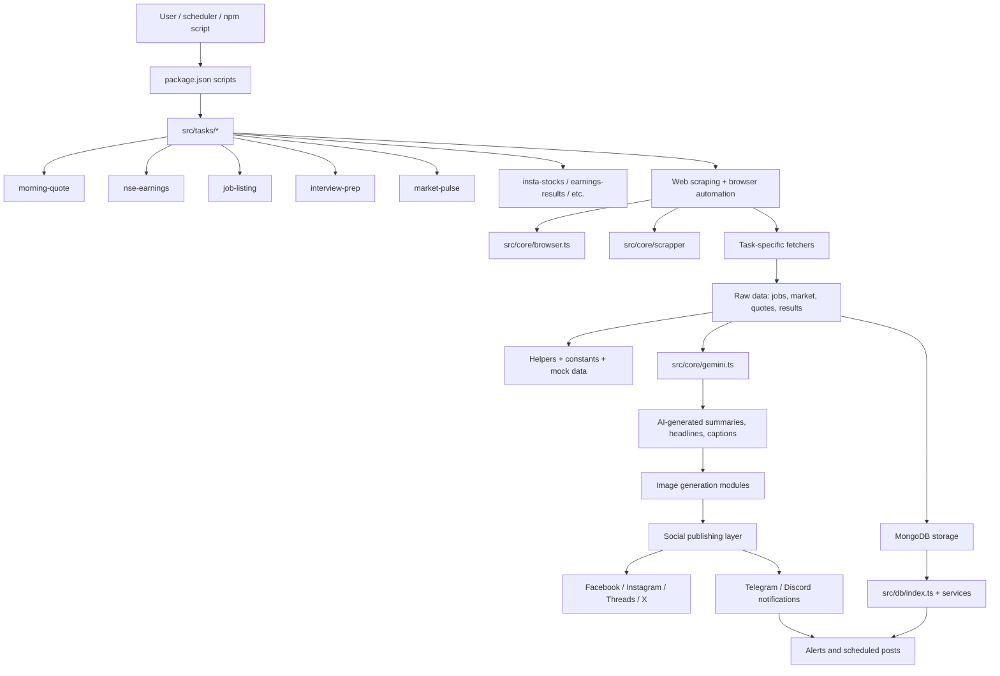
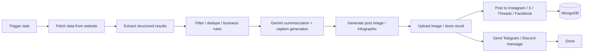
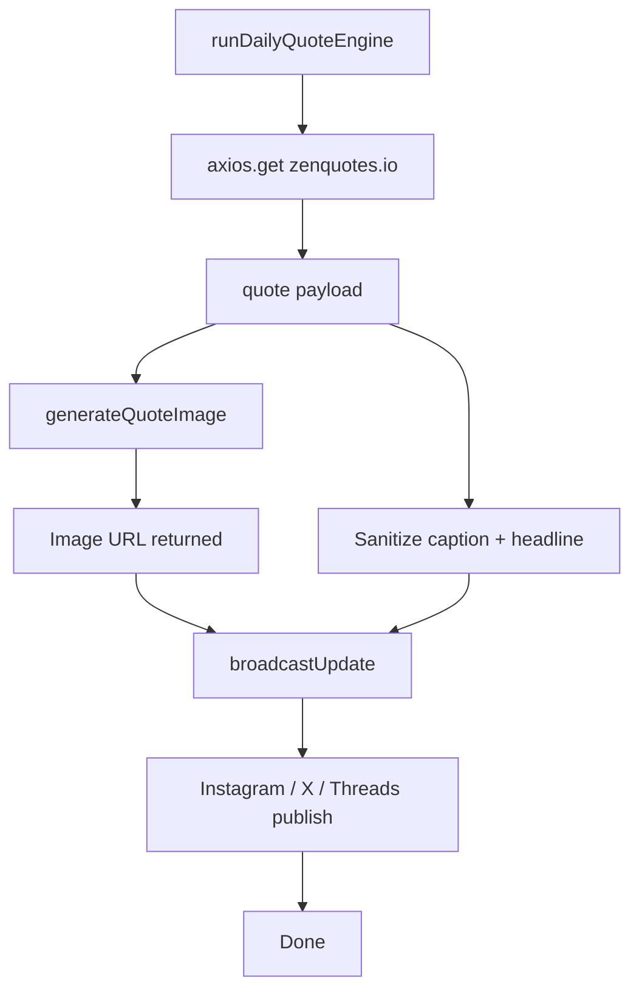

# Automation Hub Project Flow

This project is a collection of automation tasks that scrape data from the web, enrich it with Gemini AI, generate social-ready visual content, and publish it to social channels or messaging apps.

## High-level architecture

## Typical task flow

## Example: morning quote engine

## Key project components

- src/tasks/: independent automation tasks such as market updates, job scraping, quote posting, interview prep, and NSE monitoring.
- src/core/: shared infrastructure for browser automation, AI, image uploads, notifications, and social media publishing.
- src/db/: MongoDB connection and service layer for storing scraped or processed results.
- lib/: constants, mock data, and helper utilities used across tasks.
- package.json: entry points for different automation jobs.

## Execution model

Most tasks follow the same pattern:

1. Launch a browser or call a public API.
2. Scrape or fetch raw data.
3. Validate and normalize the data.
4. Pass it to Gemini for summarization or extraction.
5. Generate a visual asset or formatted message.
6. Save to MongoDB if needed.
7. Publish it to social media or notify via Telegram/Discord.

This is effectively a modular automation framework for content and data workflows rather than a single app.
